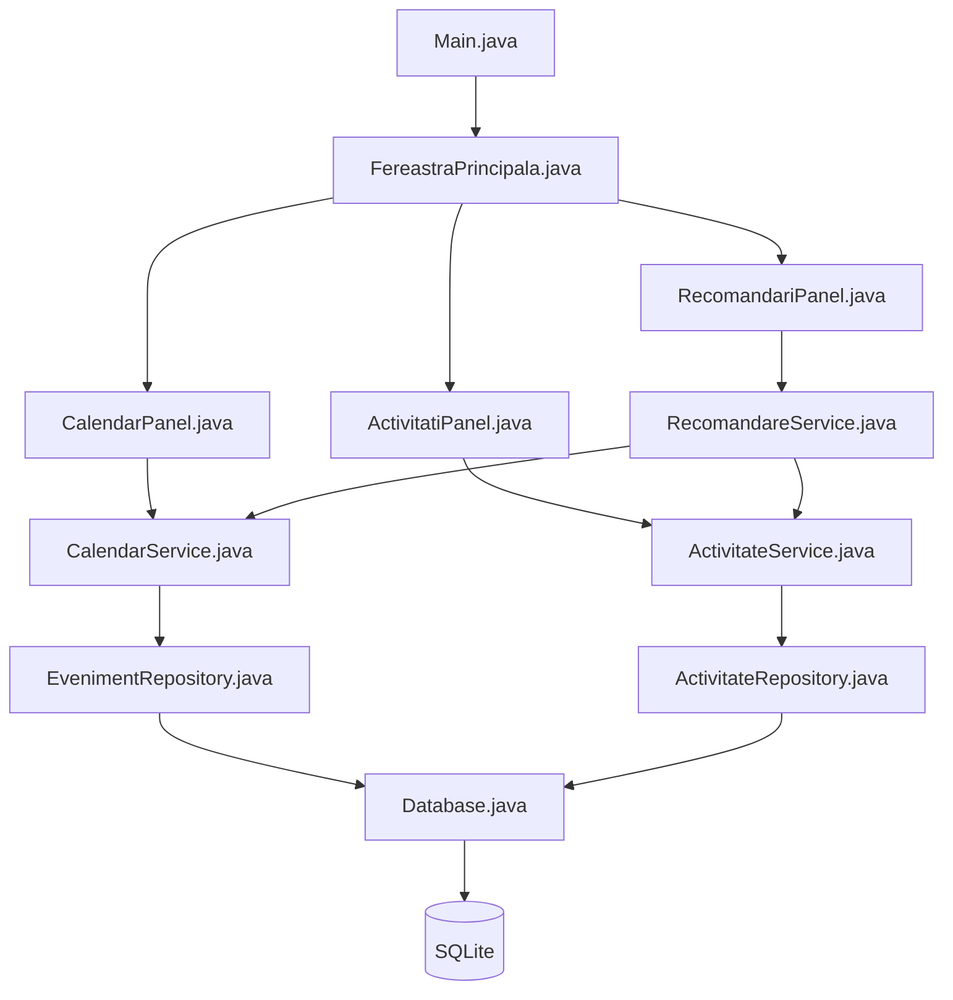
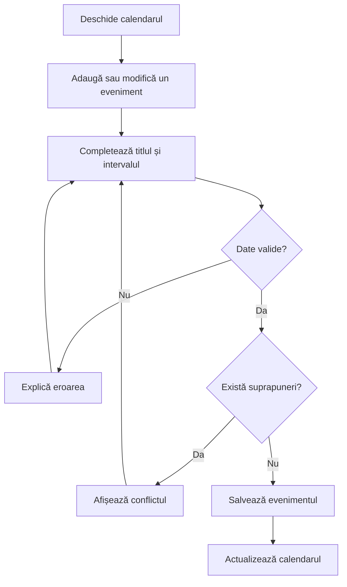
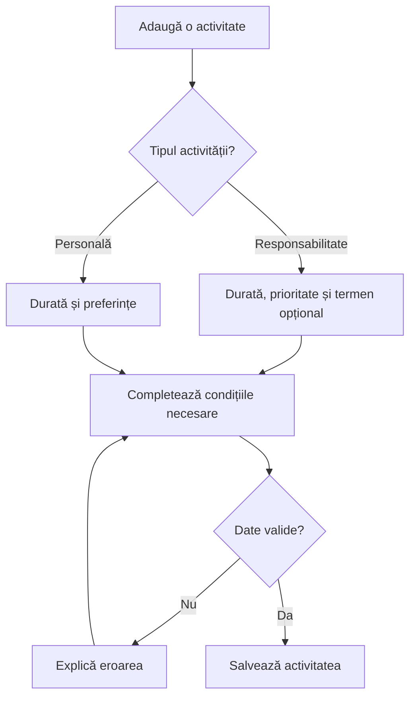
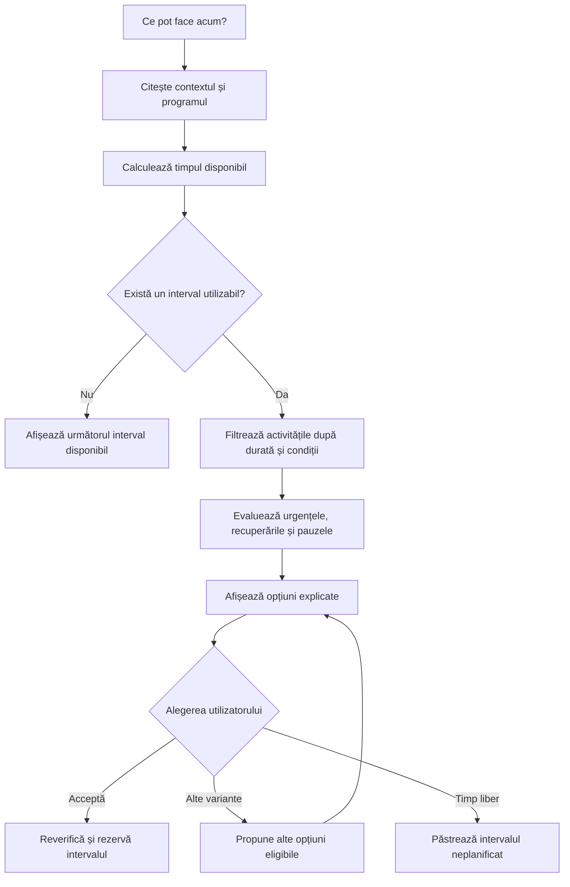
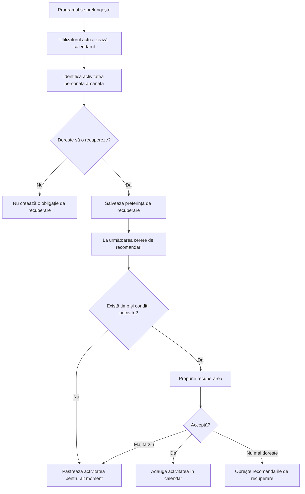

# Ce pot face acum?
### Organizarea responsabilităților și recuperarea timpului personal

Proiect Individual - Butoi Alexandru - Gabriel

## Problema identificată

Oamenii cu un program încărcat trebuie să împartă timpul între responsabilități, odihnă și activități personale. Unele activități au ore fixe, iar altele pot fi realizate în intervalele disponibile.

Din conversațiile echipei a reieșit că, atunci când o sarcină durează mai mult decât era prevăzut, timpul pentru odihnă și relaxare este adesea sacrificat. Activitățile personale fără un termen clar sunt amânate și pot rămâne uitate, chiar dacă ulterior apar intervale libere.

Problema nu este doar identificarea timpului disponibil, ci și alegerea unei activități potrivite și găsirea unui nou moment pentru lucrurile personale la care utilizatorul a renunțat.

## Scopul aplicației

„Ce pot face acum?” este o aplicație desktop care ajută utilizatorul să își organizeze programul și să aleagă activități potrivite pentru timpul disponibil.

Aplicația combină un calendar săptămânal editabil cu recomandări pentru responsabilități, odihnă și activități personale. Funcția centrală este readucerea în atenție a activităților personale amânate și propunerea unor momente potrivite pentru recuperarea lor.

Utilizatorul păstrează controlul asupra programului. Recomandările pot fi acceptate, amânate sau refuzate, iar timpul liber poate rămâne neplanificat. Relaxarea nu este tratată ca o obligație sau ca o restanță.

## Publicul țintă

Grupul inițial este format din studenți cu un program încărcat, care combină facultatea cu proiecte, muncă, voluntariat și activități personale.

Aplicația este gândită astfel încât să poată fi folosită și de alte persoane care întâmpină dificultăți în păstrarea unui echilibru între responsabilități și timpul personal.

Primele discuții și teste vor urmări nevoile studenților, înainte de extinderea către alte categorii de utilizatori.

## Cum funcționează

1. Utilizatorul introduce activitățile fixe din săptămână, precum cursuri, program de muncă și întâlniri.
2. Adaugă responsabilitățile flexibile, împreună cu durata estimată, termenul opțional și condițiile necesare.
3. Introduce activități personale pe care dorește să le facă, precum plimbări, sport, citit sau alte hobby-uri.
4. Când programul se schimbă, actualizează activitățile afectate și poate marca o activitate personală pentru recuperare.
5. La apăsarea butonului „Ce pot face acum?”, aplicația identifică timpul disponibil și propune câteva opțiuni potrivite.
6. Utilizatorul alege dacă acceptă o recomandare, cere alte variante sau păstrează intervalul liber.

Recomandările se bazează pe programul introdus, durata activităților, condițiile declarate, apropierea termenelor și activitățile personale amânate.

## Funcționalități propuse

### 1. Calendar săptămânal editabil

Utilizatorul poate adăuga, modifica și șterge activități cu dată, oră de început și oră de sfârșit.

Activitățile pot fi recurente. La modificarea unei activități recurente, utilizatorul poate alege între schimbarea unei singure apariții și schimbarea întregii serii.

Aplicația semnalează suprapunerile și permite rezervarea intervalelor pentru somn, odihnă sau alte activități care nu trebuie ocupate de recomandări.

### 2. Gestionarea responsabilităților flexibile

Pentru fiecare responsabilitate se pot introduce:

- titlul;
- durata estimată;
- termenul, dacă există;
- prioritatea;
- condițiile necesare, precum accesul la laptop sau prezența într-un anumit loc;
- posibilitatea realizării în mai multe sesiuni.

Activitățile pot fi editate, finalizate sau eliminate. Pentru cele începute se poate actualiza timpul estimat rămas.

### 3. Activități personale și preferințe

Utilizatorul poate adăuga activități care îi fac plăcere, precum citit, chitară, plimbări, sport sau timp cu prietenii.

Pentru fiecare activitate poate stabili:

- durata preferată și, opțional, o durată minimă acceptabilă;
- condițiile necesare;
- preferința pentru interior sau aer liber;
- dacă dorește să primească sugestii pentru acea activitate.

Activitățile personale nu necesită un termen și nu sunt marcate automat ca restante.

### 4. Înregistrarea schimbărilor și amânărilor

Când o activitate se prelungește, utilizatorul poate modifica durata acesteia din interfață.

Aplicația recalculează intervalele disponibile și semnalează activitățile afectate. Utilizatorul decide ce mută sau anulează.

Dacă renunță la o activitate personală, poate alege opțiunea „Vreau să o recuperez”. Aceasta devine disponibilă pentru recomandări ulterioare.

### 5. Recomandări prin „Ce pot face acum?”

Aplicația identifică intervalul disponibil până la următoarea activitate fixă, scăzând o rezervă de timp configurabilă.

Sunt selectate activitățile care încap în interval și ale căror condiții sunt îndeplinite. Contextul, precum locația sau accesul la laptop, este declarat de utilizator.

Sunt verificate responsabilitățile cu termen apropiat, dar sunt luate în calcul și activitățile personale amânate și oportunitatea unei pauze.

Recomandările includ explicații scurte, de exemplu:

> „Ai 30 de minute disponibile, iar această activitate durează aproximativ 15 minute.”

### 6. Recuperarea timpului personal amânat

Aplicația păstrează activitățile personale pe care utilizatorul a ales să le recupereze.

Când apare un interval potrivit, poate propune una dintre acestea, ținând cont de durată, context și responsabilitățile urgente.

Utilizatorul poate accepta sugestia și adăuga activitatea în calendar, o poate amâna sau poate opri recomandările pentru ea.

Amânările repetate pot declanșa o întrebare despre preferința actuală a utilizatorului, fără mesaje de vinovăție sau penalizări.

### 7. Sugestii de pauză

Utilizatorul poate înregistra o sesiune de lucru și poate configura după cât timp dorește să primească o sugestie de pauză.

Aplicația poate propune odihnă, o activitate fără ecran sau o ieșire în aer liber, dacă acestea se potrivesc timpului disponibil și preferințelor declarate.

Aplicația nu presupune că poate determina automat nivelul de oboseală și nu ocupă automat toate intervalele libere.

### 8. Salvarea locală a datelor

Programul, responsabilitățile, preferințele și activitățile amânate sunt păstrate între utilizări.

Prima versiune nu necesită cont online sau sincronizare cu un serviciu extern.

## Exemplu de utilizare

Marți, un student își planifică o plimbare de 30 de minute după terminarea unei teme. Tema durează mai mult decât estimase, iar studentul renunță la plimbare.

Din aplicație, actualizează durata temei și marchează plimbarea ca activitate pe care dorește să o recupereze.

Miercuri, la ora 16:00, are 45 de minute disponibile înainte de următoarea activitate. Nu există o responsabilitate cu termen apropiat care să necesite acel interval.

Aplicația propune:

> „Ieri ai amânat plimbarea. Acum ai timp pentru o ieșire de 20 de minute, păstrând și timpul necesar pregătirii următoarei activități. Vrei să ieși?”

Studentul poate accepta, cere o altă sugestie sau păstra timpul liber.

## Soluții existente și diferențiere

Cercetarea inițială a identificat aplicații cu funcții apropiate:

| Aplicație | Funcții relevante |
|---|---|
| Reclaim | Planificarea flexibilă și reprogramarea rutinelor, inclusiv a activităților personale. |
| Tiimo | Calendar, sarcini, rutine și adaptarea programului la schimbări. |
| Listless | Recomandări de activități în funcție de timpul disponibil, dispoziție și energie. |

Prin urmare, simpla combinare a unui calendar cu recomandări și pauze nu reprezintă, în sine, o noutate.

Contribuția propusă pentru „Ce pot face acum?” este urmărirea explicită a activităților personale amânate din cauza responsabilităților și propunerea recuperării lor în intervale potrivite.

Acest mecanism reprezintă o direcție de diferențiere care trebuie verificată în continuare. Nu este susținută, în această etapă, unicitatea aplicației pe piață.

Surse pentru analiza inițială:

- [Reclaim — Habits Overview](https://help.reclaim.ai/en/articles/4129152-habits-overview-auto-schedule-flexible-time-for-your-routines)
- [Tiimo — AI Planning](https://www.tiimoapp.com/product/ai-planning)
- [Listless — prezentarea din App Store](https://apps.apple.com/ro/app/listless-gentle-productivity/id6756637192)

## Impact estimat

Aplicația urmărește:

- reducerea efortului de alegere a unei activități potrivite pentru timpul disponibil;
- readucerea în atenție a activităților personale amânate;
- sprijinirea păstrării timpului pentru odihnă și relaxare;
- simplificarea ajustării programului după întârzieri.

Aceste beneficii sunt ipoteze care vor fi evaluate prin testare.

Evaluarea poate urmări:

- utilitatea percepută a recomandărilor;
- numărul sugestiilor acceptate și motivele refuzului;
- câte activități personale amânate sunt efectiv reluate;
- efortul necesar introducerii și actualizării datelor;
- dacă sugestiile sunt percepute ca ajutor sau ca presiune suplimentară.

Aplicația nu poate crea timp suplimentar și nu poate garanta echilibrul personal. Utilitatea sa depinde de calitatea recomandărilor și de cât de ușor poate fi folosită în viața de zi cu zi.

## Tehnologii propuse

- **Java:** implementarea aplicației și a regulilor de recomandare.
- **Swing:** interfața grafică, formularele și vizualizarea săptămânală.
- **java.time:** gestionarea datelor, orelor și duratelor.
- **SQLite, prin JDBC:** salvarea locală a datelor.
- **JUnit:** verificarea logicii de identificare a intervalelor libere și de selectare a recomandărilor.

Recomandările vor folosi reguli explicite și filtrări. Prima versiune nu necesită inteligență artificială.

Organizarea propusă separă interfața grafică, modelele de date, logica de recomandare și accesul la date.

## Arhitectura propusă

Aplicația este împărțită în patru componente:

- **Interfață:** calendarul, formularele și recomandările afișate.
- **Logică:** verificarea programului și selectarea activităților potrivite.
- **Modele:** obiectele care reprezintă evenimentele, activitățile și recomandările.
- **Persistență:** citirea și salvarea datelor în SQLite.

Săgețile indică folosirea unei componente de către alta.



### Structura fișierelor

```text
src/main/java/ro/uvt/cepotfaceacum/
    Main.java

    model/
        Eveniment.java
        Activitate.java
        ContextActual.java
        Recomandare.java

    ui/
        FereastraPrincipala.java
        CalendarPanel.java
        ActivitatiPanel.java
        RecomandariPanel.java

    service/
        CalendarService.java
        ActivitateService.java
        RecomandareService.java

    repository/
        Database.java
        EvenimentRepository.java
        ActivitateRepository.java
```

### Responsabilitățile fișierelor

#### Pornirea aplicației

- **`Main.java`**
  - Inițializează baza de date și componentele aplicației.
  - Deschide interfața grafică.

#### Modele

- **`Eveniment.java`**
  - Reprezintă un interval ocupat din calendar.
  - Conține identificatorul, titlul, începutul și sfârșitul.
  - Include informațiile necesare repetării săptămânale.

- **`Activitate.java`**
  - Reprezintă o responsabilitate sau o activitate personală.
  - Conține durata estimată, durata minimă opțională, termenul și prioritatea.
  - Păstrează condițiile necesare și starea activității.
  - Reține dacă utilizatorul dorește recuperarea unei activități amânate.

- **`ContextActual.java`**
  - Reprezintă momentul și condițiile pentru care sunt cerute recomandări.
  - Conține data, ora, locația declarată și resursele disponibile.
  - Poate include timpul disponibil introdus de utilizator.

- **`Recomandare.java`**
  - Conține activitatea sugerată, intervalul propus și explicația.
  - Este calculată pe baza datelor actuale, fără a ocupa automat calendarul.

#### Interfață

- **`FereastraPrincipala.java`**
  - Organizează navigarea între cele trei ecrane.
  - Actualizează ecranele după modificarea datelor.

- **`CalendarPanel.java`**
  - Afișează calendarul săptămânal.
  - Permite adăugarea, modificarea și ștergerea evenimentelor.
  - Afișează conflictele semnalate de logica aplicației.

- **`ActivitatiPanel.java`**
  - Afișează responsabilitățile și activitățile personale.
  - Permite adăugarea, editarea, finalizarea și eliminarea lor.
  - Permite marcarea unei activități personale pentru recuperare.

- **`RecomandariPanel.java`**
  - Permite introducerea contextului actual.
  - Afișează sugestiile și explicațiile.
  - Permite acceptarea, refuzarea sau solicitarea altor variante.
  - Permite alegerea unei pauze fără activitate planificată.

#### Logica aplicației

- **`CalendarService.java`**
  - Validează intervalele și verifică suprapunerile.
  - Calculează aparițiile evenimentelor recurente.
  - Identifică intervalele disponibile, respectând perioadele rezervate.
  - Adaugă în calendar o recomandare acceptată, după reverificarea intervalului.

- **`ActivitateService.java`**
  - Validează și gestionează activitățile.
  - Actualizează progresul și timpul estimat rămas.
  - Înregistrează amânările și preferința de recuperare.
  - Elimină marcajul de recuperare după realizare sau la cererea utilizatorului.

- **`RecomandareService.java`**
  - Solicită intervalele disponibile și activitățile eligibile.
  - Filtrează după durată și condițiile necesare.
  - Ia în calcul termenele apropiate și activitățile personale amânate.
  - Poate include o sugestie de pauză pe baza timpului de lucru declarat.
  - Returnează câteva opțiuni și explică alegerea lor.

#### Persistență

- **`Database.java`**
  - Gestionează conexiunea la SQLite.
  - Creează tabelele necesare la prima pornire.

- **`EvenimentRepository.java`**
  - Citește, adaugă, modifică și șterge evenimentele din baza de date.

- **`ActivitateRepository.java`**
  - Citește și salvează activitățile, stările și informațiile de recuperare.

## Fluxurile principale

### 1. Introducerea sau modificarea programului



Interpretare:

1. Utilizatorul selectează o zi sau un eveniment existent.
2. Completează datele și eventuala repetare săptămânală.
3. Aplicația verifică intervalul și suprapunerile.
4. Dacă există un conflict, utilizatorul îl corectează.
5. Evenimentul valid este salvat și afișat.

### 2. Adăugarea unei activități



Interpretare:

1. Utilizatorul alege între responsabilitate și activitate personală.
2. Completează durata și informațiile relevante.
3. Precizează condițiile, precum accesul la laptop sau prezența acasă.
4. Aplicația validează datele și salvează activitatea.

### 3. Obținerea recomandărilor



Interpretare:

1. Utilizatorul declară contextul actual.
2. Aplicația calculează timpul disponibil, cu o rezervă pentru tranziție.
3. Selectează activitățile realizabile în acel context.
4. Ia în calcul responsabilitățile urgente și activitățile personale amânate.
5. Prezintă câteva opțiuni, fără a le introduce automat în calendar.
6. La acceptare, verifică din nou disponibilitatea și salvează alegerea.
7. Dacă nu există o activitate potrivită, permite păstrarea timpului liber.

### 4. Amânarea și recuperarea unei activități personale



Interpretare:

1. Prelungirea unei responsabilități nu șterge automat activitățile personale.
2. Utilizatorul decide ce amână și dacă dorește recuperarea.
3. Activitatea devine eligibilă pentru sugestii viitoare.
4. Recomandarea apare când utilizatorul solicită opțiuni și există condiții potrivite.
5. Acceptarea rezervă timp; realizarea efectivă se confirmă separat.
6. Utilizatorul poate renunța oricând la recuperare.

## Corespondența dintre funcționalități și implementare

| Funcționalitate | Interfață | Logică principală | Date persistente |
|---|---|---|---|
| Calendar săptămânal | `CalendarPanel` | `CalendarService` | `EvenimentRepository` |
| Responsabilități flexibile | `ActivitatiPanel` | `ActivitateService` | `ActivitateRepository` |
| Activități personale | `ActivitatiPanel` | `ActivitateService` | `ActivitateRepository` |
| Înregistrarea amânărilor | `ActivitatiPanel` | `ActivitateService` | `ActivitateRepository` |
| Calcularea timpului disponibil | `RecomandariPanel` | `CalendarService` | `EvenimentRepository` |
| Recomandări și pauze | `RecomandariPanel` | `RecomandareService` | Date citite din ambele repository-uri |
| Recuperarea timpului personal | `RecomandariPanel` | `RecomandareService`, `ActivitateService` | Ambele repository-uri |
| Salvare locală | Toate ecranele, prin servicii | Serviciile corespunzătoare | `Database` și repository-uri |

Structura este propusă pentru prima versiune și va fi actualizată odată cu implementarea. După validarea cerințelor, fiecare funcționalitate va primi un identificator pentru a putea fi urmărită până la cod și scenariile de verificare.

## Etape următoare

### A. Prezentarea proiectului — etapa actuală

Pregătirea unei prezentări PPT care cuprinde:

- problema și motivația;
- descrierea aplicației;
- caracteristicile propuse;
- publicul țintă și impactul estimat;
- analiza soluțiilor existente;
- contribuția propusă și limitele sale.

### B. Solicitările potențialilor utilizatori

Discuții despre experiențe concrete și testarea unor exemple de recomandări.

Cerințele rezultate vor fi numerotate și separate de presupunerile inițiale. Vor fi urmărite în special efortul de introducere a datelor și felul în care utilizatorii doresc să recupereze activitățile personale.

### C. Dezvoltarea proiectului

Definirea arhitecturii și implementarea modulelor:

- calendar;
- responsabilități și activități personale;
- înregistrarea amânărilor;
- recomandări;
- persistență.

Codul va fi organizat astfel încât fiecare modul să poată fi identificat în arhitectură și urmărit în implementare.

### D. Verificare și validare

Verificarea fiecărei cerințe prin scenarii de utilizare și teste potrivite.

Testarea cu utilizatori va urmări dacă aplicația oferă recomandări realizabile și ajută la reluarea activităților personale amânate.

Va fi redactat un manual de utilizare pentru introducerea programului, actualizarea activităților și folosirea recomandărilor.

### Calendar orientativ al disciplinei

- **Noiembrie–decembrie:** versiune beta.
- **Decembrie–ianuarie:** susținere finală.

Datele exacte vor fi stabilite conform cerințelor disciplinei